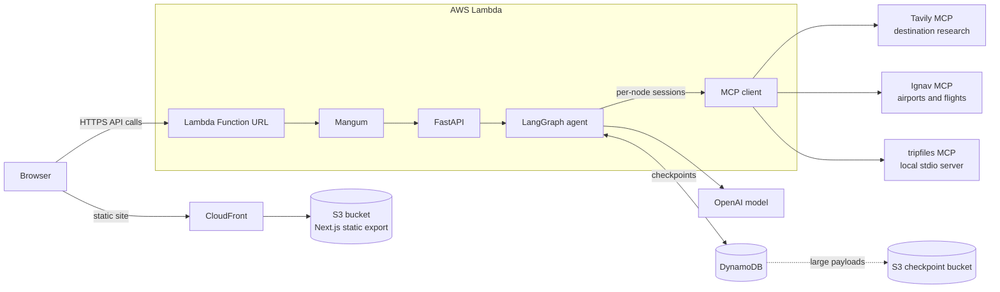
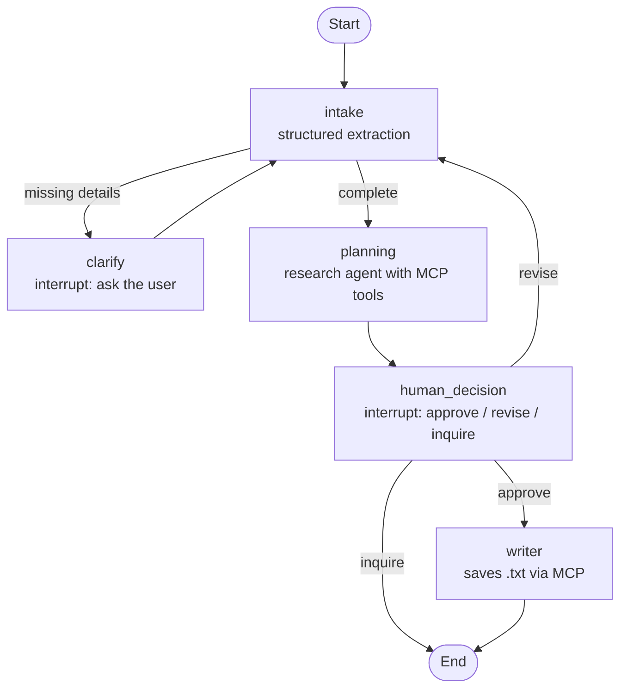

# ✈️ TripCraft AI

**A serverless AI travel-planning agent: LangGraph + MCP + FastAPI on AWS Lambda, with human-in-the-loop approval and persistent memory in DynamoDB and S3.**


🔗 **Live demo:** [d1lq4ei4qae2tr.cloudfront.net/product](https://d1lq4ei4qae2tr.cloudfront.net/product/)

---

## Overview

TripCraft AI turns a plain-language request such as *"Cologne to Lisbon, 10–15 March, two travellers, we like food and history"* into a researched trip plan with:

- ✈️ live flight options and prices
- 🏨 hotel and neighbourhood suggestions
- 🎟️ things to do, matched to the traveller's interests
- 📅 events during the travel dates
- 🚇 local transport and visa / entry information
- 💶 a budget snapshot based only on real prices returned by the tools

The user stays in control. The agent asks for missing details, presents the plan, and then waits for the user to **approve**, **revise** or **keep** it. Only after approval does it save the plan as a downloadable text file.

The main focus of the project is the **end-to-end AWS deployment** of a stateful, human-in-the-loop agent. The conversation state survives between HTTP requests, because a serverless function forgets everything once it returns.

---

## Architecture



| Layer | Technology |
|---|---|
| Frontend | Next.js (static export), React, TypeScript, Tailwind CSS, react-markdown |
| Hosting | S3 + CloudFront |
| API | FastAPI wrapped with Mangum, running on AWS Lambda |
| API entry point | Lambda Function URL |
| Agent orchestration | LangGraph (graph, interrupts, agents) |
| Tools | Model Context Protocol (Tavily, Ignav, and a custom file-writing MCP server) |
| Memory | LangGraph `DynamoDBSaver` with S3 offload |
| Packaging | Docker-based build that produces a Lambda-compatible ZIP |

---

## How the agent works



1. **Intake** reads the whole conversation and fills a validated Pydantic model (`TravelDetails`). It never guesses dates, budgets, nationality or airport codes. Dates must be explicit `YYYY-MM-DD` values and cannot be in the past.
2. **Clarify** pauses the graph with a LangGraph `interrupt` whenever something essential is missing, and loops until the user answers.
3. **Planning** is a tool-using agent. It resolves airports, searches flights, then researches hotels, activities, events, transport and entry requirements.
4. **Human decision** pauses again and lets the user approve, request changes, or keep the options and stop.
5. **Writer** is a second agent whose only job is to save the approved plan to a text file through the custom MCP file server.

### Guardrails built into the prompts and tools

- **Strict tool routing.** Flight data comes *only* from the Ignav flight tool. The web-search tool is forbidden from supplying flight information.
- **No invented facts.** Prices, airport codes, events and visa rules must come from tool results. General recommendations are labelled *"General guide (not live-verified)"*.
- **Exact data preservation.** Flight prices, currencies and booking links are passed through unchanged. The writer must copy URLs character for character.
- **Sandboxed file writes.** The custom MCP server only writes `.txt` files inside a configured sandbox directory and rejects any path that escapes it.

---

## AWS deployment

### Persistent memory with DynamoDB and S3

Every request to a Lambda function can land in a fresh execution environment, so in-memory state is not an option. TripCraft stores LangGraph checkpoints in **DynamoDB** through `DynamoDBSaver`. Larger serialized payloads are offloaded to an **S3 bucket**.

This is what makes human-in-the-loop work over plain HTTP. The graph pauses at an interrupt, the state is persisted under the conversation's `thread_id`, and a later `/resume` call (possibly on a different Lambda instance) continues exactly where it stopped. The checkpointer uses an explicit allowlist for the project's Pydantic models, so deserialization stays strict.

### Lambda Function URL instead of API Gateway

The planning step makes many sequential LLM and MCP tool calls and can run longer than 30 seconds. **API Gateway HTTP APIs have a hard 30-second integration timeout**, which returned `INTEGRATION_TIMEOUT` errors during testing. The API is therefore exposed through a **Lambda Function URL**, which is limited only by the function's own timeout. CORS is handled in FastAPI and configured through an environment variable.

### MCP inside Lambda

MCP connections are opened **per graph node** and closed when the node finishes, so only the nodes that need tools pay for connection setup. Two remote servers (Tavily, Ignav) are reached over HTTP. A third, `tripfiles`, is a small custom MCP server launched as a stdio subprocess with `python -m backend.tools`. Running it as a module keeps relative imports working inside the Lambda package.

### Packaging

`backend/deploy.py` builds the deployment package inside the official AWS Lambda Python container image with `--platform linux/amd64`. This produces dependencies that match the Lambda runtime even when the build machine is an Apple Silicon Mac. The ZIP is uploaded through S3 and used as the function's code.

### Configuration (Lambda environment variables)

| Variable | Purpose |
|---|---|
| `OPENAI_API_KEY` | LLM provider key |
| `TAVILY_API_KEY` | Destination research via Tavily MCP |
| `IGNAV_API_KEY` | Airports and flights via Ignav MCP |
| `CHECKPOINT_BUCKET` | S3 bucket for large checkpoint payloads |
| `CHECKPOINT_TABLE` | DynamoDB table name (default `tripcraft-checkpoints`) |
| `AWS_REGION` | Region for DynamoDB and S3 |
| `CORS_ORIGINS` | Comma-separated allowed frontend origins |
| `TRIP_PLANNER_SANDBOX` | Writable directory for saved plans (`/tmp/travel_plan_file` on Lambda) |
| `TRIP_PLANNER_MODEL` | Optional model override (default `gpt-4o`) |

The function's execution role needs access to the DynamoDB table and the S3 bucket.

> A step-by-step deployment walkthrough is available in [`docs/`](docs/).

---

## API

| Method | Endpoint | Description |
|---|---|---|
| `GET` | `/api/health` | Health check with model and memory backend |
| `POST` | `/api/trip/start` | Start a new planning run: `{ "question": "...", "thread_id": "..." }` |
| `POST` | `/api/trip/resume` | Answer an interrupt: `{ "thread_id": "...", "action": "approve \| revise \| inquire", "message": "..." }` |

Responses carry a `status` of `waiting_for_user` (with an `interrupt_type` of `clarify` or `decision`) or `finished` (with the saved plan). The frontend generates a `thread_id` in the browser to tie one visitor to one LangGraph thread. Starting a request on a thread that is still waiting for an answer returns `409`.

---

## Project structure

```
.
├── backend/
│   ├── app.py              # FastAPI app, CORS, start/resume endpoints
│   ├── lambda_handler.py   # Mangum entry point for Lambda
│   ├── pipeline.py         # LangGraph nodes, routing, graph assembly
│   ├── prompts.py          # Intake, research-agent and writer prompts
│   ├── schemas.py          # Pydantic models, graph state, helpers
│   ├── tools.py            # MCP client toolbox, LangChain tools, custom MCP file server
│   ├── memory.py           # DynamoDB + S3 checkpointer
│   ├── config.py           # Environment, AWS settings, MCP server config
│   └── deploy.py           # Docker-based Lambda ZIP builder
├── docs/                   # Deployment guide
├── package.json            # Next.js frontend
├── next.config.js          # Static export configuration
├── requirements.txt        # Backend dependencies
└── .env.example            # Required environment variables (no secrets)
```

---

## Running locally

**Prerequisites:** Python 3.12+, Node.js, an OpenAI key, Tavily and Ignav keys, and AWS credentials with access to a DynamoDB table and an S3 bucket (the app builds its DynamoDB checkpointer on startup).

```bash
# Backend
python -m venv .venv && source .venv/bin/activate
pip install -r requirements.txt
cp .env.example .env        # then fill in your keys
uvicorn backend.app:app --reload --port 8000
```

```bash
# Frontend (new terminal)
npm install
npm run dev                 # http://localhost:3000
```

Point the frontend at your API base URL in its configuration, and make sure `CORS_ORIGINS` includes `http://localhost:3000`.

---

## Known limitations and next steps

- **No authentication yet.** The public demo is open, so rate limiting or an API key would be the first hardening step.
- **Long-running requests.** A planning run stays open until it completes. An asynchronous start-and-poll flow would improve the experience.
- **Ephemeral file storage.** Saved plans are written to Lambda's `/tmp` and returned in the same response. They are not stored permanently.

---

## Author

Built by [GabrielGT01](https://github.com/GabrielGT01).
